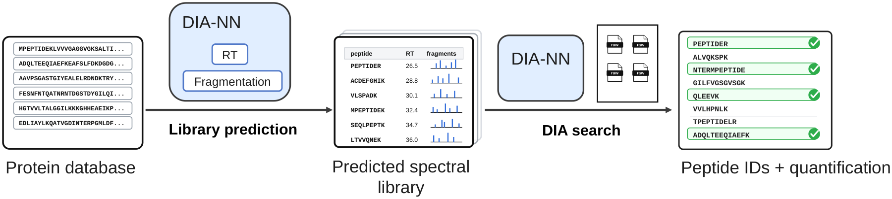
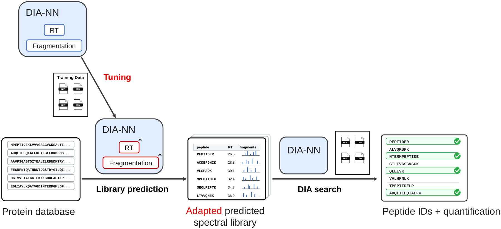

# DIA-NN Fine-Tuning Workflow (Bash-based)

> This repository documents reusable pipeline software. Research results and manuscript materials are maintained separately.

## Workflow overview

### Without model tuning

[](docs/images/diann_baseline_workflow.pdf)

DIA-NN predicts a spectral library from a protein-sequence database, then uses
that library to identify and quantify peptides in the DIA files. This is the
unchanged-model baseline used in the thesis.

### With integrated model tuning

[](docs/images/diann_workflow.pdf)

A separate search of training files supplies the empirical library for model
tuning. The adapted predictors then generate the library for the same held-out
files used by the baseline. The preparatory search is not shown; asterisks mark
adapted predictors.

Both figures are reproduced from the thesis. Click a figure for the vector PDF.

## Pipeline features

This repository implements a minimal, reproducible DIA-NN workflow to:

1) build a predicted spectral library (optional but recommended),
2) **generate calibration reference libraries** from a few "good" DIA runs,
3) generate an empirical tuning library from those same high-quality runs,
4) fine-tune DIA-NN prediction models (RT/IM; optionally fragments), and
5) build a refined library from predicted lib + tuned models, and
6) run the full dataset using the refined/tuned setup.

The orchestrator also supports source-aware dataset YAMLs with a selectable
`DATASET_TYPE` (`prehunter` or `hunter`), so one dataset file can hold both
source layouts when needed.

Design principles:
- **one Bash script = one DIA-NN call**
- **stable config layering**:
  - `config/paths.cfg` for base paths and executables
  - `config/defaults.cfg` for global analysis defaults (all steps)
  - `config/cal.cfg` for calibration-specific defaults (mass-accuracy settings)
  - `config/step1.cfg` for Step-1-specific switches/overrides
  - `config/make_cal.cfg` for calibration-helper-specific switches/overrides
  - `config/step2.cfg` for Step-2-specific switches/overrides
  - `config/step3.cfg` for Step-3-specific switches/overrides
  - `config/step4.cfg` for Step-4-specific switches/overrides
  - `config/step5.cfg` for Step-5-specific switches/overrides
- **experiment folders** are created under `OUTBASE/<expname>/` so that all steps share inputs/outputs consistently.

`OUTBASE` is derived from `DIANN_BIN` in `config/paths.cfg` so the output root
tracks the DIA-NN version directory automatically.

> Important: Keep digestion and modification settings consistent across Steps 2–5. Otherwise tuning and final quantification are not comparable.

---

## Requirements

Use Linux with Bash 4.3 or newer, a compatible DIA-NN executable, and the
Python dependencies listed in `config/python-requirements.txt`. The scripts
use associative arrays and `[[ -v ... ]]`; macOS's bundled Bash 3.2 is not
supported. External Carafe2 workflows require a separately installed Carafe2
checkout and its dependencies.

## Quick start

### 1) Configure paths and defaults

First create an untracked machine configuration, from `diaNN_pipline/`:

```bash
cp config/machines/template.cfg config/machines/local.cfg
export DIANN_MACHINE=local
```

Set `DIANN_BIN`, `RAWBASE`, `DATASET_ROOT`, `FASTABASE`, `OUTROOT`, `TMPBASE`
and the Python interpreter paths in `config/machines/local.cfg`, then run
`bash bin/check_machine_config.sh`. Keep `config/paths.cfg` as the shared
loader; do not put machine-specific paths in it.

- `config/defaults.cfg`
  - `THREADS`, `QVALUE`
  - digestion settings (e.g. `CUT`, missed cleavages, peptide length)
  - modifications (fixed/variable)
  - RAM logging settings (`RAM_LOG_ENABLE`, `RAM_LOG_STEPS`, `RAM_LOG_INTERVAL`) — **enabled by default as of April 2026**
  - dataset source selection (`DATASET_TYPE=prehunter|hunter`)
  - any stable DIA-NN flags you always want (stored in `EXTRA_FLAGS`)

- `config/cal.cfg`
  - mass-accuracy settings (`MASS_ACC`, `MASS_ACC_MS1`, optional `MASS_ACC_MS2`)
  - used by calibration/search steps; not used by Step 1 predictor call

- `config/step1.cfg`
  - Step-1 specific `enable_*` switches (mapped to DIA-NN flags)
  - optional Step-1 specifics like `LIB` for `--lib`

### 2) Config precedence and overrides

For `bin/step1_predlib.sh`, configuration is applied in this order:

1. `config/paths.cfg`
2. `config/defaults.cfg`
3. `config/step1.cfg`
4. CLI overrides via `--set KEY=VALUE`

So `--set` always wins for that run.

For `bin/step2_tunelib.sh`, configuration is applied in this order:

1. `config/paths.cfg`
2. `config/defaults.cfg`
3. `config/step2.cfg`
4. CLI overrides via `--set KEY=VALUE`

Step 2 also supports CLI source selection/overrides:
- raw inputs via repeated `--f <file>`
- or `--run-list <file>` (default fallback: `LISTBASE/good_runs.txt`)
- library override via `--lib <path_or_name>`
- optional calibration reference override via `--ref <path_or_name>`

For `run_all.sh`, `DATASET_TYPE` is read from `config/defaults.cfg` and can be
overridden with `--set DATASET_TYPE=prehunter` or `--set DATASET_TYPE=hunter`.

Examples:

```bash
# override DIA-NN binary only for this run
bash bin/step1_predlib.sh --expname auto --fasta my.fasta --set DIANN_BIN=/path/to/diann

# override mass accuracy only for this run
bash bin/step1_predlib.sh --expname auto --fasta my.fasta --set MASS_ACC=10
```

---

## Experiment naming (`--expname`)

All step scripts accept:

- `--expname <name>`: store results under `OUTBASE/<name>/...`
- `--expname auto`: create a new timestamped folder automatically:
  `exp_YYYY_MM_DD_HH_MM_SS`

Examples:

```bash
# automatic timestamped experiment folder
bash bin/step1_predlib.sh --expname auto

# explicit experiment name
bash bin/make_cal_lib.sh --expname exp_human_01
bash bin/step2_tunelib.sh --expname exp_human_01
bash bin/step3_tune_models.sh --expname exp_human_01
bash bin/step4_create_tuned_predlib.sh --expname exp_human_01 --fasta my.fasta --models-dir /abs/path/to/03_tune_models/lr_xxx
bash bin/step5_quant.sh --expname exp_human_01 --fasta my.fasta --lib step1_exp_human_01_predicted.predicted.speclib --run-list /abs/path/to/all_runs.txt
```

All steps **must use the same expname** if you want them to build on each other.

---

## Orchestrator (`run_all.sh`) — central pipeline orchestration

**Script:** `run_all.sh`

Central orchestrator that manages the pipeline workflow from Step 1 through Step 5. It handles:
- dataset validation and file resolution
- multi-profile calibration (balanced/fast/slow) with optional parallel execution
- FASTA management
- command building and progress tracking

### Current implementation

**Executes:**
1. **Step 1 (Predicted Library)** → `bin/step1_predlib.sh` with full FASTA
2. **Calibration Helper (make_cal_lib)** → `bin/make_cal_lib.sh` (1 or 3 profiles, orchestrated externally by `run_all.sh`)
3. **Step 2 (Tuning Library)** → `bin/step2_tunelib.sh` (1 or 3 profiles, profile-aware refs)
4. **Step 3 (Model Tuning)** → `bin/step3_tune_models.sh` (1 or 3 profiles, profile-aware tunelibs + refs)
5. **Step 4 (Refined Predicted Library)** → `bin/step4_create_tuned_predlib.sh` (profile/LR/model-target matrix, orchestrated in `run_all.sh`)
6. **Step 5 (Quant Search)** → `bin/step5_quant.sh` (baseline + tuned profile/LR/model-target matrix, orchestrated in `run_all.sh`)

**Profile support:** Steps 1–5 are profile-aware (balanced/fast/slow/all) with explicit profile naming.

**Orchestration rule in `run_all.sh`:**
- For `--profile all`, the profile loop is handled in `run_all.sh` for `make_cal_lib`, `step2_tunelib`, `step3_tune_models`, Step4 model consumption, and Step5 tuned quant.
- This means `run_all.sh` explicitly runs `balanced`, `fast`, `slow` outside the step scripts (sequentially or in parallel, depending on `--profile-parallel`).
- **Parallelization scope:** `--profile-parallel` runs **profiles only** (at most 3 in parallel), not LR/model combinations.
  - Step4/Step5: LR/model/target combinations are executed **sequentially within each profile**; profiles run in parallel (if enabled) with `THREADS/3` each.
  - Example: with `--profile all --profile-parallel` and `TUNE_LR=0.0001:0.001:0.0001 STEP4_MODEL_TARGETS=all,rt`: 3 profiles run concurrently, each with all LR values and targets processed one by one.
- The internal `--profile all` capability in `bin/make_cal_lib.sh` remains available for standalone usage, but is not used by `run_all.sh`.

### CLI Usage

```bash
bash run_all.sh \
  --expname <name|auto> \
  --ds <dataset> \
  [--fasta <filename>|--fasta-abs <path>|--fasta-kind full|swiss|--fasta-entrap [full|swiss]] \
  [--profile balanced|fast|slow|all|fast,slow] \
  [--profile-parallel] \
  [--no-cal-lib] \
  [--ram-log] \
  [--ram-log-steps all|step1,make_cal,step2,step3,step4,step5] \
  [--ram-log-interval <seconds>] \
  [--set KEY=VALUE ...] \
  [--test] \
  [--test-full] \
  [-v|--verbose]
```

### Key arguments

| Argument | Type | Default | Usage |
|----------|------|---------|-------|
| `--expname` | required | — | Experiment folder name or `auto` for timestamp |
| `--ds` | required | — | Dataset YAML selector (id, relative path, or absolute) |
| `--fasta` | optional | dataset YAML selection | FASTA filename in `FASTABASE`; overrides dataset YAML |
| `--fasta-abs` | optional | dataset YAML selection | Absolute FASTA path; overrides dataset YAML |
| `--fasta-kind` | optional | `full` | Dataset FASTA selector when no FASTA override is provided: `full` uses `fasta.fasta`, `swiss` uses `fasta.fasta_swiss` |
| `--fasta-entrap` | optional flag/value | inactive | Use/create a combined original+shuffled entrapment FASTA in `FASTABASE`; optional value `full` or `swiss` selects the dataset YAML FASTA to entrap |
| `--fasta-entrap-shuffle` | optional | `fixed-r` | Entrapment shuffle mode: `fixed-r` keeps `R` positions fixed, `simple` is the legacy tail shuffle |
| `--profile` | optional | `balanced` | Calibration profile: `balanced`, `fast`, `slow`, `all`, or a comma-separated selection such as `fast,slow` |
| `--profile-parallel` | flag | inactive | Run multiple selected profiles concurrently; divides `THREADS` by the number of selected profiles; Step4/5 combinations remain sequential within each profile |
| `--no-cal-lib` | flag | inactive | Skip `make_cal_lib.sh` completely; downstream Step2/Step3 do not expect `cal_lib/*/calib_ref_*.parquet` and do not pass DIA-NN `--ref` |
| `--ram-log` | flag | **active** | RAM logging enabled by default for all steps; override via config or `--ram-log-steps` |
| `--ram-log-steps` | optional | `all` | Restrict RAM logging: `all` or subset of `step1,make_cal,step2,step3,step4,step5` (ignores config default) |
| `--ram-log-interval` | optional | `10` | RAM log sampling interval in seconds (from `config/defaults.cfg`, default: 10s) |
| `--ram-plot` | flag | inactive | Write one PNG next to each RAM log file |
| `--set KEY=VALUE` | optional | — | Override config variable for this run |
| `--test` | flag | inactive | Dry-run: compact structured output (validate, check inputs, print summary); no execution or file creation |
| `--test-full` | flag | inactive | Dry-run full verbose output; implies `--test` |
| `-v, --verbose` | optional | 0 | Enable debug logs (levels 0–4) |

## Out-lib q-value sweep (`run_out_lib_qvalue_sweep.sh`)

**Script:** `run_out_lib_qvalue_sweep.sh`

This experiment wrapper is for testing DIA-NN empirical library generation
thresholds without model tuning. It runs only:

1. Step 1 once (`bin/step1_predlib.sh`) to create the predicted library from
   the selected FASTA.
2. Step 5 repeatedly (`bin/step5_quant.sh`) over all combinations of:
   - `--qvalues`: forwarded as `STEP5_REPORT_QVALUE`, i.e. the DIA-NN Step5
     `--qvalue` parameter.
   - `--out-lib-qvalues`: forwarded via `EXTRA_FLAGS` as DIA-NN
     `--out-lib-qvalue`, i.e. the empirical-library generation q-value.

Calibration helper, Step 2, Step 3 and Step 4 are intentionally skipped.

Example:

```bash
bash run_out_lib_qvalue_sweep.sh \
  --expname md48_outlib_q_sweep \
  --ds md048 \
  --fasta-entrap full \
  --mods fixed_dimethyl_no_ac \
  --set DATASET_TYPE=hunter \
  --set THREADS=66 \
  --qvalues 0.01,0.02,0.05 \
  --out-lib-qvalues 0.001,0.005,0.01,0.05
```

Each Step5 combination is written below `05_quant/` using both thresholds in
the folder name, for example:

```text
05_quant/q_0_01__outlibq_0_001/
05_quant/q_0_01__outlibq_0_05/
05_quant/q_0_05__outlibq_0_001/
```

Supported inputs mirror the Step1/Step5-relevant subset of `run_all.sh`:
`--ds`, `--fasta`, `--fasta-abs`, `--fasta-kind`, `--fasta-entrap`,
`--mods`, repeated `--set KEY=VALUE`, `--resume`, `--ram-log`,
`--ram-log-interval`, `--test`, and `--verbose`.

Use `--resume` to reuse an existing Step1 library and skip Step5 combinations
that already contain `final_report.parquet`.

## Re-search existing experiment libraries (`run_existing_lib_searches.sh`)

**Script:** `run_existing_lib_searches.sh`

Use this when an experiment already has baseline/tuned spectral libraries and
you want to repeat only the Step 5 searches on a different dataset source. The
script reads the existing Step 5 wrapper commands from the source experiment,
keeps their FASTA, library paths, and stored `--set` overrides, then swaps in
the raw files resolved from the new `--ds`/`--dataset-type`.

Examples:

```bash
# Re-run all existing Step5 searches with hunter test files from md048.
bash run_existing_lib_searches.sh \
  --source-exp entrap_md48_lysin_dmt_fixed_n_vari_qval_decoys \
  --ds md048 \
  --dataset-type hunter

# Preview only the baseline command.
bash run_existing_lib_searches.sh \
  --source-exp maya48 \
  --ds md048 \
  --dataset-type hunter \
  --search baseline \
  --test
```

Output directories are labelled to avoid overwriting the original searches:
baseline becomes `05_quant/<label>/baseline`, and tuned searches become
`05_quant/<label>/<old_tuned_name>`. The default label is
`<dataset_id>_<dataset_type>`, or set it explicitly with `--out-label`,
`--group-name`, or `--run-name`. Add `--resume` to skip searches whose target
report already exists. Use `--verbose 4 --ram-log --ram-log-interval 1
--ram-plot` to mirror the high-verbosity/RAM-traced Step5 style from
`run_all.sh`; RAM logs are written into the corresponding `05_quant/<label>/...`
search folders.

## Search with externally trained models (`run_external_model_search.sh`)

This registry-based workflow changes only the RT model: it derives the FASTA,
test raw files, digestion/modification parameters, instrument, profile, and
the original fragment model from a completed experiment. Steps 1–3 are never
rerun. Results remain in the source experiment under
`external_searches/<model-id>/<search-id>/`, containing `04_refined_lib/`,
`05_quant/`, logs, commands, manifest, and status. Cluster is the default.

```bash
# Required dry run: validates the registry package and prints final commands.
bash run_external_model_search.sh \
  --experiment triplemix_source_a_entrap_neu \
  --model-id diannrt_09eca3b5f83d \
  --search-id triplemix_smoketest_v1 \
  --executor cluster --resume --test

# Submit the same validated search.
bash run_external_model_search.sh \
  --experiment triplemix_source_a_entrap_neu \
  --model-id diannrt_09eca3b5f83d \
  --search-id triplemix_smoketest_v1 \
  --executor cluster --resume
```

For several experiments with the same external model, repeat `--experiment`
and set a bounded parallelism. On the cluster this submits one SLURM array with
the `%2` concurrency cap. Unless `--threads` is supplied, the recorded
per-experiment thread count is divided by `--parallel` (rounded up).

```bash
bash run_external_model_search.sh \
  --experiment triplemix_source_a_entrap_neu \
  --experiment triplemix_bigger_source_b_entrap_neu \
  --model-id diannrt_09eca3b5f83d \
  --search-id parallel_smoketest \
  --executor cluster --parallel 2 --resume --test
```

This example uses 80 threads per search when both recorded experiments use
160. Its independent output directories are
`triplemix_source_a_entrap_neu/external_searches/<model-id>/parallel_smoketest/`
and
`triplemix_bigger_source_b_entrap_neu/external_searches/<model-id>/parallel_smoketest/`.

For different models, repeat `--model-id` as well. Model and experiment
occurrences are paired by position, regardless of whether the arguments are
written interleaved or grouped:

```bash
bash run_external_model_search.sh \
  --experiment triplemix_source_a_entrap_neu \
  --model-id diannrt_model_a \
  --experiment combined_md48_cluster \
  --model-id diannrt_model_b \
  --search-id external_rt_two_models_v1 \
  --executor cluster --threads 80 --parallel 2 --test
```

This runs `triplemix_source_a_entrap_neu` with `diannrt_model_a` and
`combined_md48_cluster` with `diannrt_model_b`. Passing exactly one
`--model-id` retains the shared-model behavior above. Any other number of
model IDs is rejected before preparation or submission.

When the launcher is called from an existing allocation with
`EXTERNAL_MODEL_DIRECT_EXECUTION=1`, it starts these as bounded background
workers on that node instead of submitting a nested SLURM array. Thus
`--parallel 2 --threads 80` uses two simultaneous DIA-NN workers with 80
threads each, matching a 160-CPU wrapper job.

The model ID is looked up in
`${EXTERNAL_MODELS_ROOT}/diann/models_list.csv`. The package checksum and the
DIA-NN version contract are validated before submission. Results are written to
`<experiment>/external_searches/<model-id>/<search-id>/`, including a manifest,
state file, resolved config, commands, logs, `04_refined_lib/`, and `05_quant/`.
RAM logging is enabled by default: each Step 4 and Step 5 writes its own
`ram_*.txt`, with per-run process memory and whole-node memory columns. The
worker copies `model_package/` directly into that external-search directory and
verifies it again. Step 4 and Step 5 also run directly there; no second global
scratch tree or result synchronization is used.

Every external search writes an isolated
`<experiment>/external_searches/<model-id>/<search-id>/progress.txt` containing
only that external run's preparation, execution, Step 4/5, evaluation, and
failure/completion records. Step 4 and Step 5 are always invoked with
`--verbose 4`. All external-model launches also append to the central registry log
`${EXTERNAL_MODELS_ROOT}/diann/progress.txt`. It uses the same tab-separated
`timestamp, step, state, details` convention as experiment `progress.txt`
files and records preparation, worker start, Step 4, Step 5, MA-plot readiness,
completion, and failures. Concurrent workers serialize their writes.

## Overview: Steps 1–5

### Step 1 — Build a predicted spectral library (optional but recommended)
**Script:** `bin/step1_predlib.sh`

**Goal:** Generate an in silico/predicted library from the FASTA using DIA-NN’s predictor.

**Inputs:**
- FASTA (target organism; and optional contaminants if you concatenate them)
- global digestion/modification settings from `config/defaults.cfg`
- Step-1 specific switches from `config/step1.cfg`

CLI input for FASTA:
- `--fasta <filename>` (resolved relative to `FASTABASE`)
- or `--fastaabs <absolute_path>`

**Outputs (written under):**
- `OUTBASE/<expname>/01_predlib/`
  - predicted library file (e.g. `predicted.speclib`)
  - report file (e.g. `predlib_report.parquet`)
  - `Temp/` (passed to DIA-NN via `--temp`)
  - `step1_predlib.log` (live pipeline + DIA-NN log)
  - `startcmd.txt` (fully resolved command that was executed)

**Verbose behavior (`--verbose`):**
- Supports DIA-NN levels `0..4`:
  - `--verbose 2`
  - `--verbose=2`
  - `--verbose` (without value) => level `1`
  - `-v` / `--v` => level `1`
- The same numeric level is forwarded to DIA-NN as `--verbose <N>`.
- Internal pipeline debug logging is enabled when `N > 0`.

**Test mode (`--test`):**
- validates executable + required input paths and prints the fully resolved DIA-NN command
- does not create directories/files and does not run DIA-NN

**Enable-flag mapping (Step 1):**
- `enable_*` keys from `defaults.cfg` and `step1.cfg` are mapped to DIA-NN CLI flags.
- If an `enable_*` variable is set to `1` but not mapped in Step 1, the script logs a warning.

**Notes:**
This provides a consistent base library for downstream runs and simplifies reproducibility.
Some workflows skip this and do library-free search, but here we keep Step 1 explicit.

### Calibration ref library (helper) — build `--ref` input from a few good runs
**Script:** `bin/make_cal_lib.sh`

**Goal:** Build small calibration/reference libraries (`calib_ref_<profile>.parquet`) from 1..N high-quality DIA runs, using the Step-1 predicted library as search input. One output per selected profile. These are intended for DIA-NN `--ref` usage in downstream steps.

**How to call:**

```bash
bash bin/make_cal_lib.sh \
  --expname exp_human_01 \
  --fasta my.fasta \
  --lib OUTBASE/exp_human_01/01_predlib/step1_exp_human_01_predicted.speclib \
  --profile balanced \
  --f /path/good_run_01.mzML --f /path/good_run_02.mzML \
  --verbose 2
```

**Profile-aware execution:**

| Profile | Output path | Flags | Use case |
|---------|-------------|-------|----------|
| `balanced` (default) | `cal_lib/balanced/` | none | Standard search window, most analyses |
| `fast` | `cal_lib/fast/` | `--rt-window-mul 1.7 --rt-window-factor 100` | Faster search, well-calibrated RT |
| `slow` | `cal_lib/slow/` | `--no-rt-window` | Maximum sensitivity, poor RT calibration |
| `all` | `cal_lib/{balanced,fast,slow}/` | (one per profile) | Benchmark all strategies |

**Execution modes:**
- **single profile** (e.g., `--profile fast`): one DIA-NN call, full `THREADS`, output to `cal_lib/fast/`
- **all sequential** (`--profile all`, default): runs balanced → fast → slow sequentially
- **all parallel** (`--profile all --profile-parallel`): runs all 3 concurrently, each with `THREADS/3`

**Profile-specific output files:**
Each profile generates a timestamped subfolder under `cal_lib/<profile_name>/`:
- `calib_ref_<profile_name>.parquet` — calibration reference library (passed to Step 2 via `--ref`)
- `calib_report_<profile_name>.parquet` — DIA-NN search report for this calibration run
- `make_calibration_lib_<profile_name>.log` — step execution log
- `startcmd_<profile_name>.txt` — exact command that was executed

**Config/precedence:**
- loads `config/paths.cfg` first (e.g. `DIANN_BIN`, `FASTABASE`, `OUTBASE`)
- then `config/defaults.cfg` (threads, qvalue, digestion, mass-accuracy, mods, `enable_*`, `EXTRA_FLAGS`)
- then `config/make_cal.cfg` (make-cal-only overrides, e.g. `enable_PRE_SEARCH=1`)
- selected CLI args override config for that run

**What it does internally:**
- resolves FASTA via `--fasta <name>` from `FASTABASE` or via absolute `--fastaabs`
- requires at least one input run via repeated `--f`
- loops over selected profiles
- for each profile, builds one DIA-NN command with the appropriate profile flags
- writes profile-specific outputs under `cal_lib/<profile>/`

**Test mode:**
- `--test` validates executable + paths and prints the exact DIA-NN start command(s)
- with `--profile all`, test mode prints three planned DIA-NN commands (one per profile)
- does not create directories/files and does not run DIA-NN

**Examples:**

```bash
# single balanced profile
bash bin/make_cal_lib.sh \
  --expname exp_01 \
  --fasta organism.fasta \
  --lib /path/to/predicted.speclib \
  --f good_01.mzML --f good_02.mzML

# all 3 profiles sequential
bash bin/make_cal_lib.sh \
  --expname exp_02 \
  --fasta organism.fasta \
  --lib /path/to/predicted.speclib \
  --profile all \
  --f good_01.mzML --f good_02.mzML

# all 3 profiles parallel
bash bin/make_cal_lib.sh \
  --expname exp_03 \
  --fasta organism.fasta \
  --lib /path/to/predicted.speclib \
  --profile all \
  --profile-parallel \
  --set THREADS=120
```

**Output structure after `--profile all` run:**
```
cal_lib/
  balanced/
    calib_ref_balanced.parquet
    calib_report_balanced.parquet
    make_calibration_lib_balanced.log
    startcmd_balanced.txt
  fast/
    calib_ref_fast.parquet
    calib_report_fast.parquet
    make_calibration_lib_fast.log
    startcmd_fast.txt
  slow/
    calib_ref_slow.parquet
    calib_report_slow.parquet
    make_calibration_lib_slow.log
    startcmd_slow.txt
```

---

### Step 2 — Generate an empirical tuning library from “good runs”
**Script:** `bin/step2_tunelib.sh`

**Goal:** Select a small set of high-quality DIA runs and generate an **empirical spectral library** enriched for peptides/proteoforms (including modified ones) under your project’s settings.

**Config/override model:**
- loads `paths.cfg` + `defaults.cfg` + `step2.cfg`
- supports run-specific overrides via `--set KEY=VALUE`

**Inputs:**
- raw DIA files either by:
  - repeated `--f <rawfile>` (absolute path, or path resolved relative to `RAWBASE`), or
  - `--run-list <file>` (one file per line), fallback to `LISTBASE/good_runs.txt`
- library:
  - if `--lib` is omitted: Step 2 searches `OUTBASE/<expname>/01_predlib/` for exactly one file ending in `.predicted.speclib` or `.parquet`
  - if zero matches: error; if multiple matches: error (use `--lib` explicitly)
  - override: `--lib <path_or_name>`
- calibration reference (`--ref` or default lookup):
  - explicit: `--ref <path_or_name>` (absolute or relative to `OUTBASE/<expname>/cal_lib/<profile>/`)
  - if omitted: Step 2 attempts auto-discovery (3-tier fallback):
    1. tries `OUTBASE/<expname>/cal_lib/<profile>/calib_ref_<profile>.parquet` (profile-suffixed name)
    2. tries `OUTBASE/<expname>/cal_lib/<profile>/calib_ref.parquet` (legacy-in-profile name)
    3. tries `OUTBASE/<expname>/cal_lib/calib_ref.parquet` (global legacy name)
  - logs a warning if using legacy (non-suffixed) filename
  - resolved ref file must exist
- no-calibration mode:
  - `--no-cal-lib` disables calibration lookup entirely
  - Step 2 does not pass DIA-NN `--ref`
  - `--caltype fixed`, `--ref`, `--mass-acc-cal`, and `--min-cal` cannot be combined with `--no-cal-lib`
- FASTA (required):
  - `--fasta <filename>` (resolved via `FASTABASE`)
  - or `--fastaabs <absolute_path>`
  - or set `FASTA=...` in `config/step2.cfg`
- digestion/modification settings from `defaults.cfg`

**Profile support:**
- `--profile balanced|fast|slow|all` (default: `balanced`)
- profile determines which calibration reference is used and where outputs are written
- single profile: `--profile fast` → reads `cal_lib/fast/calib_ref_fast.parquet`, writes to `02_tunelib/fast/`
- all profiles: `--profile all` (sequential) or `--profile all --profile-parallel` (concurrent)

**Profile-specific output files:**
Each profile writes to `OUTBASE/<expname>/02_tunelib/<profile_name>/`:
- `tune_lib_<profile_name>.parquet` — empirical tuning library (passed to Step 3 via default lookup)
- `tune_search_report_<profile_name>.parquet` — DIA-NN search report for this tuning run
- `step2_tunelib_<profile_name>.log` — step execution log
- `startcmd_<profile_name>.txt` — exact command that was executed

**Important for `--lib`, `--ref`:**
- absolute path: used directly
- path containing `/`: used as given
- basename only (e.g. `my_lib.parquet`): resolved to `OUTBASE/<expname>/01_predlib/<name>`
- `--ref-expname` and `--ref` are mutually exclusive

**Cross-experiment asset reuse:**
- `--lib-expname <exp>`: auto-lib search happens in that experiment folder
- `--ref-expname <exp>`: default ref lookup happens in that experiment folder

**Important for calibration:**
- whenever calibration is used (ref-based), Step 2 requires `--pre-search` enabled
- controlled via `enable_PRE_SEARCH=1` in config
- automatic in this pipeline
- with `--no-cal-lib`, Step 2 still runs the tuning-library search, but without any calibration reference or fixed calibration parameters

**Verbose behavior (`--verbose`) in Step 2:**
- Supports DIA-NN levels `0..4` (`--verbose 2`, `--verbose=2`, `--verbose`, `-v`, `--v`)
- forwarded to DIA-NN as `--verbose <N>`
- internal pipeline debug is enabled when `N > 0`

**Test mode (`--test`) in Step 2:**
- validates executable + required FASTA + resolved calibration settings (`--ref`/default-ref or `--mass-acc-cal`/`--min-cal`) + resolved `--lib`/auto-lib + raw inputs and prints the fully resolved DIA-NN command
- does not create directories/files and does not run DIA-NN
- new experiment folders do not need to exist in advance; only `OUTBASE` must exist/writable

**Enable-flag mapping (Step 2):**
- mapped if set to `1`: `enable_GEN_SPEC_LIB`, `enable_REANNOTATE`, `enable_SEMI`, `enable_PEPTIDOFORMS`, `enable_PROTEOFORMS`, `enable_UNIMOD4`, `enable_PRE_SEARCH`/`enable_pre_search`
- unmapped `enable_*` set to `1` are reported as warnings

**Examples:**

```bash
# single fast profile, explicit input files
bash bin/step2_tunelib.sh \
  --expname exp_human_01 \
  --profile fast \
  --fasta my.fasta \
  --f good/run_01.mzML --f good/run_02.mzML --f good/run_03.mzML \
  --verbose 2

# all 3 profiles, auto-refs from make_cal_lib, parallel execution
bash bin/step2_tunelib.sh \
  --expname exp_human_01 \
  --profile all \
  --profile-parallel \
  --fasta my.fasta \
  --run-list /path/to/good_runs.txt

# explicit library + ref from another experiment
bash bin/step2_tunelib.sh \
  --expname exp_new_run \
  --profile balanced \
  --fasta my.fasta \
  --lib /path/to/exp_other/01_predlib/predicted.speclib \
  --ref-expname exp_other \
  --run-list /path/to/good_runs.txt
```

**Why it matters:**
Tuning quality depends on the empirical library. If the library is weak (few relevant IDs, few modified peptides), tuning will likely not help. Use high-quality runs for this step.

**Output structure after `--profile all` run:**
```
02_tunelib/
  balanced/
    tune_lib_balanced.parquet
    tune_search_report_balanced.parquet
    step2_tunelib_balanced.log
    startcmd_balanced.txt
  fast/
    tune_lib_fast.parquet
    tune_search_report_fast.parquet
    step2_tunelib_fast.log
    startcmd_fast.txt
  slow/
    tune_lib_slow.parquet
    tune_search_report_slow.parquet
    step2_tunelib_slow.log
    startcmd_slow.txt
```

---

### Step 3 — Fine-tune DIA-NN prediction models (RT/IM, optionally fragments)
**Script:** `bin/step3_tune_models.sh`

**Goal:** Fine-tune DIA-NN's predictors using the empirical tuning library from Step 2. Outputs are profile-specific.

**Config/override model:**
- loads `paths.cfg` + `defaults.cfg` + `step3.cfg`
- supports run-specific overrides via `--set KEY=VALUE`

**Inputs:**
- tuning library from Step 2 (required source): auto-discovered or via `--lib`
  - default: tries to find profile-named tune_lib from Step 2 (3-tier fallback similar to Step 2 ref resolution)
- calibration reference for DIA-NN `--ref`:
  - explicit via `--ref <path_or_name>`
  - if omitted: Step 3 attempts auto-discovery with 3-tier fallback:
    1. tries `OUTBASE/<expname>/cal_lib/<profile>/calib_ref_<profile>.parquet`
    2. tries `OUTBASE/<expname>/cal_lib/<profile>/calib_ref.parquet`
    3. tries `OUTBASE/<expname>/cal_lib/calib_ref.parquet`
  - logs a warning if using legacy (non-suffixed) filename
- no-calibration mode:
  - `--no-cal-lib` disables calibration reference lookup
  - Step 3 fine-tunes from the Step2 tuning library without passing DIA-NN `--ref`
- Step 3 copies source library to `OUTBASE/<expname>/03_tune_models/<profile>/tune_lib_<profile>_lr_<TUNE_LR>.parquet`
  and uses this step3-local `--tune-lib` path so DIA-NN tuned model artifacts are written under Step 3 context.
- tuning controls from `config/step3.cfg`:
  - `TUNE_TARGETS` (primary control): `all|rt|im|fr|rt,fr|rt,im|fr,im|rt,im,fr`
    - recommended default: `TUNE_TARGETS=rt,fr`
    - explicit list/all: derive effective `TUNE_RT/TUNE_IM/TUNE_FR`
    - explicit `--set TUNE_RT=.../TUNE_IM=.../TUNE_FR=...` has highest priority
    - at least one tuning dimension must remain active (script exits otherwise)
  - `INSTRUMENT` (optional): gate IM tuning (`timstof` only)
  - `TUNE_LR` -> `--tune-lr` (supports sweep syntax)
  - `enable_PRE_SEARCH` -> `--pre-search`
- optional `TUNE_RESTRICT_LAYERS=1` -> `--tune-restrict-layers`
  - `STEP3_BASEDIR_NAME=<name>` stores a Step-3 variant in a separate directory
    (default: `03_tune_models`), avoiding collisions with prior tuning runs.

**Instrument gating in Step 3 (also in standalone use):**
- Effective rule: `--tune-im` is active only when `INSTRUMENT=timstof`.
- This applies both in orchestrated runs and when `bin/step3_tune_models.sh` is called directly.

You can override pre-search at runtime with:
- `--set ENABLE_PRE_SEARCH=0` (disable)
- `--set ENABLE_PRE_SEARCH=1` (enable)

**`TUNE_LR` syntax (single value or sweep):**
- single value: `TUNE_LR=0.0005`
- comma list: `TUNE_LR=0.0005,0.001,0.002`
- range with step: `TUNE_LR=0.001:0.01:0.001` (`start:stop:step`)
- zero start is allowed, e.g. `TUNE_LR=0:0.1:0.01`, but `0` values are skipped (only `LR > 0` runs are executed)
- works both in `config/step3.cfg` and via `--set TUNE_LR=...`

When multiple LR values are resolved, Step 3 runs one DIA-NN tuning call per LR.

**Verbose behavior (`--verbose`) in Step 3:**
- Supports DIA-NN levels `0..4` (`--verbose 2`, `--verbose=2`, `--verbose`, `-v`, `--v`)
- forwarded to DIA-NN as `--verbose <N>`
- internal pipeline debug is enabled when `N > 0`

**Test mode (`--test`) in Step 3:**
- validates executable + required tune-lib input and prints the fully resolved DIA-NN command
- does not create directories/files and does not run DIA-NN
- new experiment folders do not need to exist in advance; only `OUTBASE` must exist/writable

**Profile support:**
- `--profile balanced|fast|slow|all` (default: `balanced`)
- profile determines which tune_lib and ref are used, and where outputs are written
- single profile: `--profile fast` → reads `02_tunelib/fast/tune_lib_fast.parquet`, writes to `03_tune_models/fast/`
- all profiles: `--profile all` (sequential) or `--profile all --profile-parallel` (concurrent)

**Profile-specific output files:**
Each profile writes to `OUTBASE/<expname>/03_tune_models/<profile_name>/`:
- `tune_models_<profile_name>.log` — step execution log for this profile
- `startcmd_<profile_name>.txt` — commands executed for this profile (one per LR value)
- Per-LR subdirectory `lr_<lr_tag>/`:
  - `tune_lib_<profile_name>_lr_<lr_tag>.parquet` (step3-local tune-lib input)
  - `tune_report_<profile_name>_lr_<lr_tag>.parquet` (DIA-NN `--out` for this run)
  - `run.log` (per-run log)
  - `startcmd.txt` (per-run command)
  - loss extraction outputs (if LR tuning enabled):
    - `LR_<lr_tag>_IM_LOSS.csv`, `LR_<lr_tag>_IM_LOSS.png`
    - `LR_<lr_tag>_RT_LOSS.csv`, `LR_<lr_tag>_RT_LOSS.png`
    - `LR_<lr_tag>_FR_LOSS.csv`, `LR_<lr_tag>_FR_LOSS.png`
  - DIA-NN tuned model artifacts derived from the tune-lib basename
- Combined LR loss plots (after all LR runs):
  - `ALL_LR_LOSS.csv`, `ALL_LR_IM_LOSS.png`, `ALL_LR_RT_LOSS.png`, `ALL_LR_FR_LOSS.png`

**Outputs (DIA-NN generated, location depends on DIA-NN version):**
Common artifacts include:
- `tune_lib.dict.txt` (tokens/dictionary)
- `tune_lib.tuned_rt.pt`
- `tune_lib.tuned_im.pt` (if IM tuned)
- optional tuned fragmentation model file(s) (if enabled)
- for DIA-NN 2.5.0 distillation runs, model files may also be written with `d0/d1/d2` suffixes

These artifacts are expected under:
- `OUTBASE/<expname>/03_tune_models/` (logs)
and/or next to the tuning library output directory depending on DIA-NN.

> Note: Different DIA-NN builds may differ in exact filenames. The pipeline is structured so you can enforce/standardize filenames once confirmed for your DIA-NN version.

**Examples:**

```bash
# single balanced profile, auto-ref from make_cal_lib
bash bin/step3_tune_models.sh \
  --expname exp_human_01 \
  --profile balanced \
  --verbose 2

# all 3 profiles sequential, auto-refs, LR sweep
bash bin/step3_tune_models.sh \
  --expname exp_human_01 \
  --profile all \
  --set TUNE_LR='0.0005,0.001,0.002'

# all 3 profiles parallel, explicit ref
bash bin/step3_tune_models.sh \
  --expname exp_human_01 \
  --profile all \
  --profile-parallel \
  --ref /path/to/custom_ref.parquet \
  --set THREADS=120

# validation only (no execution)
bash bin/step3_tune_models.sh \
  --expname exp_human_01 \
  --profile fast \
  --test
```

### Restricted-layers variant for an existing experiment

**Script:** `run_restricted_layers_variant.sh`

Use this runner when the baseline and ordinary tuning of an experiment already
exist and only a matched `--tune-restrict-layers` variant is needed. It reads
the original tuned Step-5 start command to reuse the FASTA, test files,
selected tuning LR, verbosity, and saved `--set` overrides. It reuses the
existing `02_tunelib` input, creates separately named Step-3/4 outputs, and
runs the final search without overwriting the baseline or ordinary-tuning
results. The DIA-NN binary is also recovered from the original DIA-NN command
and forwarded as `DIANN_BIN`; a user-supplied `--set DIANN_BIN=...` is an
intentional override. The original experiment directory is located across all
configured DIA-NN version output directories, so a 2.5.0 experiment is not
accidentally redirected into a 2.6.0 directory. A single profile is run per
invocation.

```bash
# First validate the whole matched Step 3 -> Step 4 -> Step 5 variant.
bash run_restricted_layers_variant.sh \
  --expname exp_human_01 \
  --source-tuned-run balanced_rt_fr_lr_0p00011_d0 \
  --profile balanced \
  --variant-name restricted_layers \
  --test

# Remove --test to run it. Explicit --fastaabs, --run-list/--f, --tune-lr,
# --set, and --verbose arguments can be supplied to intentionally override
# values recovered from the original run.
```

When multiple original tuned searches exist, list them first and choose the
one that should serve as the matched source:

```bash
bash run_restricted_layers_variant.sh --expname exp_human_01 --list-source-runs
```

Pass one listed relative path to `--source-tuned-run`. If exactly one tuned
run exists it is selected automatically; if several exist the runner exits
instead of silently choosing one.

The runner keeps the established step roots and creates only variant-labelled
children beneath them:

```
02_tunelib/<profile>_restricted_layers/source_manifest.txt
03_tune_models/<profile>_restricted_layers/lr_<lr>/
04_refined_lib/<profile>_restricted_layers/lr_<lr>/
05_quant/tuned_restricted_layers/<profile>/lr_<lr>/
```

`02_tunelib/<profile>_restricted_layers/` contains append-only provenance for
the reused original Step-2 library; the large input library itself is not
duplicated. The Step-3 tuning-library, report, model, and Step-4 library
filenames also contain `restricted_layers`.

Every non-test run appends `START`, `OK`, `FAILED`, `SKIP`, or (when needed)
`BACKUP` records for Step 3, Step 4, and Step 5 to the existing experiment
`progress.txt`. These records include `variant=restricted_layers` and the
selected source run. The runner never deletes or rewrites existing progress
entries.

Use `--resume` to verify the restricted artifacts and skip each completed
step. If a restricted Step-3/4/5 output is incomplete, it is moved below a
timestamped `.interrupted/` directory before that step starts again; no output
or progress history is deleted. `--auto-resume` (also accepted as
`--autoresume`) reruns after a failure, adding `--resume` from the second
attempt onward. Optional controls are `--auto-resume-sleep <sec>`,
`--auto-resume-max-attempts <n>`, and `--auto-resume-log-dir <dir>`.

---

### Step 4 — Create tuned predicted library (Step 1 + tuned model args)
**Script:** `bin/step4_create_tuned_predlib.sh`

**Goal:** Build a refined/tuned predicted library using:
- Step-1-like predictor setup with `--lib "${LIB:-}"` from `config/step4.cfg` (default `LIB=""`), and
- tuned model artifacts from Step 3.

This step is intentionally **very close to Step 1**:
- same global defaults (`paths.cfg` + `defaults.cfg` + `step4.cfg`)
- same digestion/modification/mass-accuracy parameter forwarding style
- same enable-flag style from cfg
- same output auditability (`startcmd.txt`, log, temp dir)

Main differences vs Step 1:
- requires tuned model inputs (`--models-dir` OR explicit tokens/model files)
- writes to `OUTBASE/<expname>/<STEP4_BASEDIR_NAME>/` (default in cfg: `04_refined_lib_no_presearch`)
- does not accept `--lib`/`--ref` CLI inputs
- FASTA must be passed by user per run (`--fasta` or `--fastaabs`)

**Config/override model:**
- loads `paths.cfg` + `defaults.cfg` + `step4.cfg`
- supports run-specific overrides via `--set KEY=VALUE`

**Default Step4 behavior in this repo:**
- `enable_PRE_SEARCH=0` in `config/step4.cfg` ("ohne pre-search" variant)
- `STEP4_MODEL_TARGETS=all`
- `STEP4_LR_SELECT=all`
- `STEP4_DISTILL_LEVELS=0`
- `STEP4_BASEDIR_NAME=04_refined_lib_no_presearch`

**Model target selection (`STEP4_MODEL_TARGETS`):**
- allowed dimensions: `rt`, `im`, `fr`
- groups are `+`-joined, multiple groups are comma-separated
- examples: `rt`, `rt+fr`, `rt,rt+fr`, `all`
- IM is ignored automatically for non-`timstof` instruments

**LR selection from Step3 (`STEP4_LR_SELECT`):**
- `all`: use all `03_tune_models/<profile>/lr_*` folders
- `default`: use first sorted LR folder
- numeric list/range: same style as Step3 (`0.0005,0.001` or `0.0005:0.002:0.0005`)

**Required inputs:**
- FASTA is mandatory via CLI:
  - `--fasta <filename in FASTABASE>` or
  - `--fastaabs <absolute_path>`
- model artifacts are mandatory in one of two modes:
  - **Mode A (directory mode):** `--models-dir <abs_path>` (or `--set MODELS_DIR=<abs_path>`)
    - expects exactly one `*.dict.txt`
    - expects at least one of `*.tuned_rt.pt`, `*.tuned_im.pt`, `*.tuned_fr.pt`, or the corresponding `d0/d1/d2` DIA-NN 2.5.0 variants
  - **Mode B (explicit files):**
    - `--tokens <abs_path>` (or `--set TOKENS=<abs_path>`) plus
    - one or more of `--rt-model`, `--im-model`, `--fr-model` (absolute paths)

If neither mode is provided, Step 4 errors intentionally (no implicit model-dir fallback).

**Predicted library input:**
- no manual `--lib`/`--ref` CLI input in this script
- `--lib` is always appended from config as in Step 1 (`LIB=""` by default)

**Test mode (`--test`) in Step 4:**
- validates executable + required files + output paths
- prints fully resolved DIA-NN command
- does not create directories/files and does not run DIA-NN

**Outputs (run_all orchestration):**
- one Step4 run per selected combination of:
  - profile (`balanced|fast|slow` as selected)
  - LR folder (`lr_*` from Step3 according to `STEP4_LR_SELECT`)
  - model target group (`STEP4_MODEL_TARGETS`)
- each run is written under:
  - `OUTBASE/<expname>/<STEP4_BASEDIR_NAME>/<profile>/lr_<lr_tag>/`
- generated filenames include profile + targets + lr tag suffix, e.g.:
  - `refined_lib_balanced_rt_lr_0p0005.predicted.speclib`
  - `refined_lib_balanced_rt_fr_lr_0p0005.predicted.speclib`

**Examples:**

```bash
# Mode A: models directory
bash bin/step4_create_tuned_predlib.sh --expname exp_human_01 \
  --fasta my.fasta \
  --models-dir /abs/path/to/03_tune_models/lr_0p001 \
  --verbose 2 --test

# Mode B: explicit absolute files
bash bin/step4_create_tuned_predlib.sh --expname exp_human_01 \
  --fasta my.fasta \
  --tokens /abs/path/to/tune_lib.dict.txt \
  --rt-model /abs/path/to/tune_lib.tuned_rt.pt \
  --im-model /abs/path/to/tune_lib.tuned_im.pt \
  --verbose 2 --test
```

---

### Step 5 — Run the full dataset using the tuned/refined setup
**Script:** `bin/step5_quant.sh`

**Goal:** Search/quantify all DIA runs using the chosen search library.

**Inputs:**
- FASTA (required):
  - `--fasta <filename>` (resolved relative to `FASTABASE`)
  - or `--fastaabs <absolute_path>`
- base library for search (required):
  - `--lib <path_or_name>`
  - absolute path: used directly
  - path containing `/`: used as given
  - basename only: resolved to `OUTBASE/<expname>/01_predlib/<name>`
- raw DIA files (required):
  - repeated `--f <rawfile>` (absolute path, or resolved relative to `RAWBASE`)
  - or `--run-list <file>` (one run per line)
- optional output subfolder:
  - `--out-sub <relative_path>`
  - writes default Step-5 report to `OUTBASE/<expname>/05_quant/<relative_path>/final_report.parquet`
- consistent digestion/mod settings

**Config/override model:**
- loads `paths.cfg` + `defaults.cfg` + `cal.cfg` + `step5.cfg`
- supports run-specific overrides via `--set KEY=VALUE`

**Outputs (written under):**
- `OUTBASE/<expname>/04_quant/`
- `OUTBASE/<expname>/05_quant/`
  - final report(s) (e.g. `final_report.parquet`)
  - `step5_quant.log` (live pipeline + DIA-NN log)
  - `startcmd.txt` (fully resolved executed command)
  - additional quant matrices if enabled by DIA-NN args

**Verbose behavior (`--verbose`) in Step 5:**
- Supports DIA-NN levels `0..4` (`--verbose 2`, `--verbose=2`, `--verbose`, `-v`, `--v`)
- forwarded to DIA-NN as `--verbose <N>`
- internal pipeline debug is enabled when `N > 0`

**Test mode (`--test`) in Step 5:**
- validates executable + FASTA + `--lib` + raw input list + resolved command
- does not create directories/files and does not run DIA-NN

**Automatic MA plot report in `run_all.sh`:**
- enabled by default with `ENABLE_MAPLOT_REPORT=1` in `config/defaults.cfg`
- after all Step-5 baseline/tuned searches finish, `run_all.sh` runs:
  `diann_visu/post_run_reports/scripts/run_maplot_report.py`
- outputs are written to `OUTBASE/<expname>/ma_plots/`
- every figure is saved as `.png`, `.pdf`, and `.svg`
- filenames include experiment, date, context, and plot type, e.g.
  `ara_250_dmfixed_no_ac_2026-05-06_experiment_raw_search_summary.pdf`
- experiment-level UpSet plots are generated on four main ID levels:
  `Stripped.Sequence` (peptide without modification detail),
  `Modified.Sequence` (peptidoform including DIA-NN modifications),
  `Protein.Group` (DIA-NN protein grouping), and
  `nterm_modif_peptide` (N-terminal modification class plus peptide)
- disable for one run with `--no-maplot-report` or `--set ENABLE_MAPLOT_REPORT=0`
- tune with `--set MAPLOT_ORGANISM=arabidopsis`, `--set MAPLOT_MAX_MOD_UPSETS=6`,
  `--set MAPLOT_REUSE_CACHE=1`, or `--set MAPLOT_PSSM_PREDICTION=1`

See the detailed guide for integration details, plot families, and the
recommended review order:

[MA plot report guide](docs/maplot_report.md)

Manual report generation for an already finished experiment:

```bash
python \
  ./diann_visu/post_run_reports/scripts/run_maplot_report.py \
  --experiment ara_250_dmfixed_no_ac \
  --diann-out-root ./diann_out \
  --pipeline-version 2_5_0
```

Re-run the report for an experiment that was already analyzed before and reuse
cached adapted/termini tables:

```bash
python \
  ./diann_visu/post_run_reports/scripts/run_maplot_report.py \
  --experiment ara_250_dmfixed_no_ac \
  --diann-out-root ./diann_out \
  --pipeline-version 2_5_0 \
  --reuse-cache
```

Run the current three comparison experiments:

```bash
for exp in ara_250_dmfixed_no_ac ara_250_vadim_sol_swiss_vari source_a_no_ac; do
  python \
    ./diann_visu/post_run_reports/scripts/run_maplot_report.py \
    --experiment "$exp" \
    --diann-out-root ./diann_out \
    --pipeline-version 2_5_0 \
    --reuse-cache
done
```

**Examples:**

```bash
# run-list mode
bash bin/step5_quant.sh --expname exp_human_01 \
  --fasta my.fasta \
  --lib step1_exp_human_01_predicted.predicted.speclib \
  --out-sub round_1 \
  --run-list /abs/path/to/all_runs.txt \
  --verbose 2

# repeated --f mode
bash bin/step5_quant.sh --expname exp_human_01 \
  --fastaabs /abs/path/to/my.fasta \
  --lib /abs/path/to/refined_or_predicted.speclib \
  --f run_a.mzML --f run_b.mzML --f /abs/path/run_c.raw
```

**Evaluation idea:**
Run Step 5 twice at the same `QVALUE` threshold:
1) with predicted library
2) with refined/tuned library from Step 4
Compare IDs, precursor counts, protein groups, and stability across replicates.

---

## Repository structure

```text
config/
  paths.cfg        # loads and validates the selected machine configuration
  machines/
    template.cfg   # starting point for an additional server
  defaults.cfg     # stable analysis defaults (mods, digestion, tolerances, ...)
bin/
  _lib.sh
  step1_predlib.sh
  step2_tunelib.sh
  step3_tune_models.sh
  step4_create_tuned_predlib.sh
  step5_quant.sh
lists/
  good_runs.txt    # subset used for Step 2
  all_runs.txt     # full set used for final search (Step 5)
```

Copy `config/machines/template.cfg` to an untracked local configuration file, fill in paths for your environment, and select it with `DIANN_MACHINE`. Do not commit machine-specific configuration.

```bash
cp config/machines/template.cfg config/machines/local.cfg
export DIANN_MACHINE=local
bash bin/check_machine_config.sh
```

The selected machine file also defines `PIPELINE_PYTHON_PATH`,
`EVAL_PYTHON_PATH`, and `MAPLOT_PYTHON_PATH`. They may all use one environment:

```bash
/path/to/python -m pip install -r config/python-requirements.txt
```

Dataset YAML `base_dir` values are relative to the machine-specific
`DATASET_ROOT`. This keeps dataset definitions portable across environments.

The `datasets/` directory contains four sanitized benchmark configurations used
in the thesis: the combined *C. elegans* benchmark, two TripleMix benchmarks,
and MG054. Their train/test file assignments are retained. Dataset roots and
FASTA references are relative; no FASTA, RAW, mzML, sample-annotation, or
other measurement files are included. Set `DATASET_ROOT` and provide the
referenced inputs in your own environment before running a workflow.

---

## Typical run sequence

**With automatic (timestamped) experiment folder:**

```bash
# Step 1: create a fresh experiment folder automatically
bash bin/step1_predlib.sh --expname auto --fasta my.fasta

# EXPNAME will be something like: exp_YYYY_MM_DD_HH_MM_SS
# Now use the SAME expname for ALL subsequent steps

# Calibration helper: generate reference libraries (from high-quality runs)
bash bin/make_cal_lib.sh --expname exp_YYYY_MM_DD_HH_MM_SS \
  --fasta my.fasta --f good_run_01.mzML --f good_run_02.mzML [--profile all] [--profile-parallel]

# Step 2: generate empirical tuning library (from same good runs)
bash bin/step2_tunelib.sh --expname exp_YYYY_MM_DD_HH_MM_SS \
  --fasta my.fasta --f good_run_01.mzML --f good_run_02.mzML [--profile all]

# Step 3: fine-tune prediction models (using tuning library + ref from make_cal_lib)
bash bin/step3_tune_models.sh --expname exp_YYYY_MM_DD_HH_MM_SS \
  [--set TUNE_LR=0.001:0.01:0.001] [--profile all]

# Step 4: build refined predicted library (with tuned models)
bash bin/step4_create_tuned_predlib.sh --expname exp_YYYY_MM_DD_HH_MM_SS \
  --fasta my.fasta --models-dir /abs/path/to/03_tune_models/lr_xxx

# Step 5: search entire dataset with refined library
bash bin/step5_quant.sh --expname exp_YYYY_MM_DD_HH_MM_SS \
  --fasta my.fasta --lib step1_exp_YYYY_MM_DD_HH_MM_SS_predicted.speclib \
  --run-list /abs/path/to/all_runs.txt
```

**With manual experiment name:**

```bash
# Step 1: create predicted library
bash bin/step1_predlib.sh --expname exp_human_01 --fasta my.fasta

# Calibration helper: generate reference libraries
bash bin/make_cal_lib.sh --expname exp_human_01 \
  --fasta my.fasta --f good_run_01.mzML --f good_run_02.mzML [--profile all]

# Step 2: generate empirical tuning library
bash bin/step2_tunelib.sh --expname exp_human_01 \
  --fasta my.fasta --f good_run_01.mzML --f good_run_02.mzML [--profile all]

# Step 3: fine-tune prediction models
bash bin/step3_tune_models.sh --expname exp_human_01 [--profile all]

# Step 4: build refined predicted library
bash bin/step4_create_tuned_predlib.sh --expname exp_human_01 \
  --fasta my.fasta --models-dir /abs/path/to/03_tune_models/lr_xxx

# Step 5: search entire dataset with refined library
bash bin/step5_quant.sh --expname exp_human_01 \
  --fasta my.fasta --lib step1_exp_human_01_predicted.speclib \
  --run-list /abs/path/to/all_runs.txt
```

**Using run_all.sh orchestrator (Steps 1–3):**

If you want to run Steps 1–3 together with automatic profile handling, use the central orchestrator:

```bash
# Automatic timestamped experiment, all 3 profiles sequential
bash run_all.sh --expname auto --ds my_dataset --profile all

# All 3 profiles in parallel (faster, requires more resources)
bash run_all.sh --expname auto --ds my_dataset --profile all --profile-parallel

# Single profile (balanced), with validation
bash run_all.sh --expname auto --ds my_dataset --profile balanced --test
```

After Steps 1–3 complete, manually run Steps 4–5 as shown above.

---

## Notes / best practices

- **Consistency is key:** digestion + mods must match between tuning/refinement/search (Steps 2–5).
- Keep `lists/good_runs.txt` small (e.g. 3–10 high-quality runs) but representative.
- If you change `defaults.cfg` (mods/digestion), consider starting a new experiment name for clean provenance.
- Store all outputs in `OUTBASE/<expname>/` to keep runs reproducible and auditable.
- For auditability, keep `step1_predlib.log` and `startcmd.txt` together with the Step-1 outputs.
- For Step 2 auditability, keep `step2_tunelib.log` and `startcmd.txt` with the tuning outputs.

---

## Recent Changes (April 2026)

### RAM Logging Enabled by Default
- **Activation:** RAM logging is now **enabled by default** for all steps (previously off by default)
- **Default settings:** Sample every 10 seconds, all steps monitored
- **Configuration:** Edit `config/defaults.cfg` to change defaults:
  ```bash
  RAM_LOG_ENABLE=1               # 1=on, 0=off
  RAM_LOG_STEPS=all              # all | step1,make_cal,step2,step3,step4,step5
  RAM_LOG_INTERVAL=10            # sampling interval in seconds
  ```
- **CLI overrides:** `--ram-log-interval 5 --ram-log-steps step4,step5`
- **Output:** Per-step/per-run log files (e.g., `04_refined_lib/balanced/lr_0p0005/ram_step4_*.txt`)
- **Benefit:** Automatic profiling for memory bottleneck identification during Step4/Step5 benchmarking

### Step4 Parameter-aware Resume
- Resume mode now validates Step4 completion against **current parameters** (`STEP4_BASEDIR_NAME`, `STEP4_LR_SELECT`, `STEP4_MODEL_TARGETS`, `STEP4_DISTILL_LEVELS`)
- Allows running multiple Step4 variants in same experiment with different output directories
- Old Step4 runs in progress.txt are not re-accepted if parameters differ

### Flag: `--stop-after-step4`
- New CLI flag to disable Step5 quantification entirely
- Useful for RAM/time profiling of Step4 alone with different model/mod configurations
- Can be combined with `--resume` for seamless re-runs with different `--set` overrides

---

## External execution environments

Some optional workflows integrate with external model-training or library-building software. Configure executable locations, input storage, and output roots through the local configuration files or environment variables documented by the relevant scripts. Keep machine-specific settings in untracked local configuration files.
